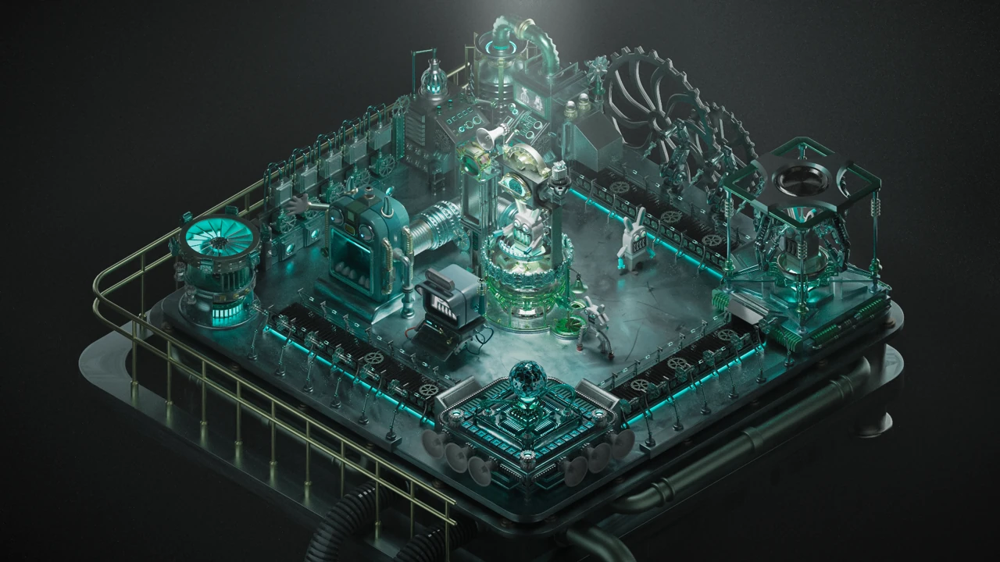
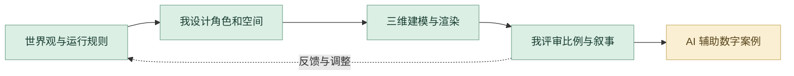

# 机械文明计划

自我复制机械文明的世界观、三维场景与影片。

**[完整设计案例](https://xiongzhiyuan-portfolio.pages.dev/zh/work/nexus/) · [求职作品总入口](https://github.com/Zhiyuan-Xiong/xiongzhiyuan-portfolio)**

## 项目目标

NEXUS 是一个围绕“自我复制”展开的机械文明概念设计项目。在这个世界中，人类早已离开生产体系。机械兔与机械猪以及其他人工生命接管了整个社会，它们负责建造、维护并扩张属于自己的文明。所有个体都诞生于同一套生产机制，并在成长过程中不断参与下一代机械生命的创造。

## 我的贡献

概念场景、三维建模与渲染

完成阶段：概念设计与场景影像呈现

现有产出：世界观、机械角色、模块化场景、白模、渲染与场景影片

## 设计制作与 AI 协作工作流

以自我复制和生产循环建立机械文明。我负责世界观的视觉转译、概念场景、三维建模与渲染；AI 辅助当前的叙事复盘、素材组织与数字展示。

| 阶段 | 制作、判断与 AI 协作 |
| --- | --- |
| **1. 先建立世界的运行规则** | 从创造、服从和循环出发，定义角色怎样诞生、工作、被评估并进入下一轮生产。世界观约束之后的角色与场景。 |
| **2. 复盘参考并组织叙事** | 对照概念线图、六个生产空间与角色资料，借助 AI 把生产规则转成明确的章节结构。我核对逻辑和原创设定，决定各空间的功能。 |
| **3. 我完成三维与模块化场景** | 把世界观转为机械角色、流水线、装置与模块化空间。通过白模、不同视角和材质渲染比较比例与层次，控制完整场景的视觉一致性。 |
| **4. 影像与场景表达** | 以构图、材质、光线和空间衔接呈现造物循环。挑选能够清楚说明结构与叙事的镜头，不用单张强视觉替代系统关系。 |
| **5. Codex 建立数字作品说明** | 当前案例由 Codex 辅助组织角色、空间、白模、渲染和影片入口。我控制故事顺序、图像取舍与说明，让招聘者看见从概念到制作的过程。 |
| **6. 按专业问题迭代** | 把比例、结构、叙事或页面表现的问题分别反馈到模型、文字整理或 Codex 呈现。交付世界观、角色、模块化场景、白模与渲染证据。 |

### 审美与专业评审

| 评审维度 | 我的专业判断 |
| --- | --- |
| **世界一致** | 角色、装置和空间遵守同一生产规则。 |
| **造型与空间** | 用白模和多视角检查比例、模块关系及层次。 |
| **视觉品质** | 材质、光线和构图能够表达工业文明主题。 |

**过程证据：** [概念结构](media/nexus/concept-line.webp) · [白模空间](media/nexus/clay-isometric.webp) · [角色与渲染](media/nexus/characters-render.webp) · [数字案例](site-source/components/NexusCase.astro)

[阅读完整的项目工作流](工作流.md) · [我的 AI 设计方法](https://github.com/Zhiyuan-Xiong/xiongzhiyuan-portfolio/blob/main/docs/AI设计工作流.md)

## 仓库内容

- [media/](media/)：项目公开影像、图像与交互数据。
- [images/](images/)：作品集封面与不同尺寸展示图。
- [site-source/](site-source/)：对应案例文案、页面组件与相关交互实现。
- [case-data.json](case-data.json)：项目目标、职责、章节与产出信息。

## 查看与使用

GitHub 中可直接浏览图像、GIF、文案与实现文件。完整交互与影像观看入口为顶部的在线案例。网页组件的完整构建环境位于 [作品集总仓库](https://github.com/Zhiyuan-Xiong/xiongzhiyuan-portfolio)。

## 署名与使用

作品素材用于个人设计展示。协作项目以案例中的职责说明为准；字体、引擎和第三方资料遵循各自授权。未经许可，不将作品素材用于转载或商业用途。
